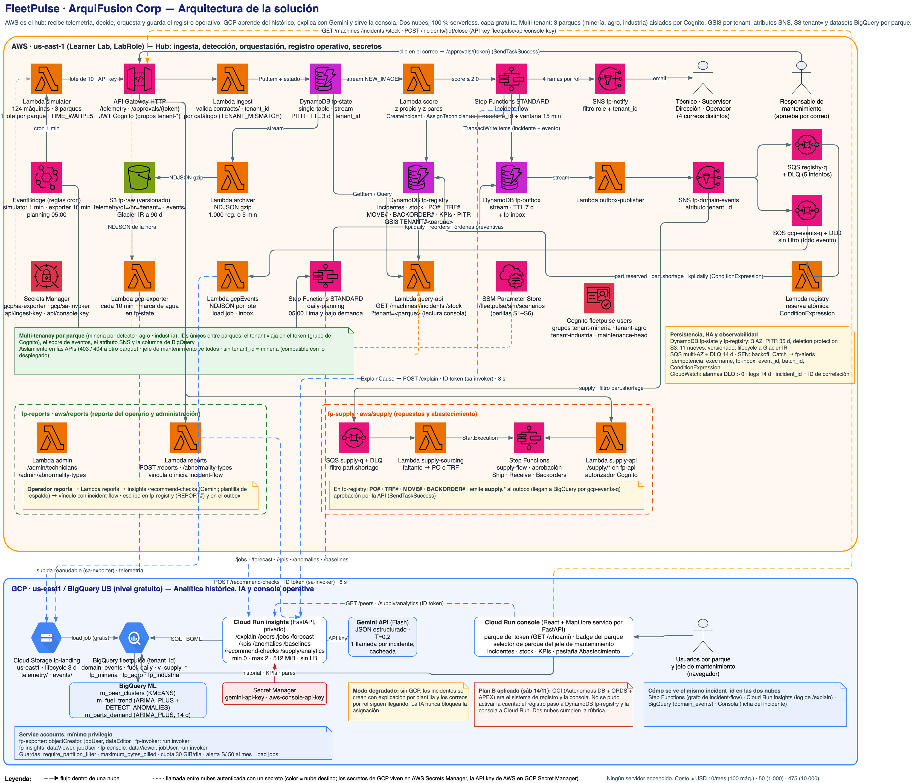

# FleetPulse — ArquiFusion Corp
Telemetría de maquinaria pesada → decisiones de mantenimiento, técnicos y repuestos. 100 % serverless en AWS + GCP.

▶ Video (4:30): _pendiente_



| Nube | Rol | Servicios |
|---|---|---|
| AWS | Ingesta, detección, orquestación, registro operativo, secretos | API Gateway, Lambda, DynamoDB, S3, SQS, SNS, Step Functions, Secrets Manager |
| GCP | Analítica histórica, IA y consola operativa | Cloud Storage, BigQuery, BigQuery ML, Cloud Run, Gemini, Secret Manager |

## Desplegar
1. `scripts/lab-creds.sh`
2. `terraform -chdir=gcp/terraform apply`
3. `bash aws/shared/build.sh && (cd aws && npm ci && npx serverless deploy)`: el stack fp-core genera las API keys `fleetpulse/api/ingest-key` y `fleetpulse/api/console-key` (único dueño)
4. `scripts/push-secrets.sh` (solo las llaves de GCP `fleetpulse/gcp/sa-*` de `.env.example`)
5. Copiar la console key a GCP Secret Manager `aws-console-api-key` (la lee el BFF de la consola; el permiso de `fp-console` está en `gcp/console/deploy.sh`):
   ```bash
   aws secretsmanager get-secret-value --secret-id fleetpulse/api/console-key --query SecretString --output text \
     | python3 -c 'import json,sys; print(json.load(sys.stdin)["api_key"], end="")' \
     | gcloud secrets create aws-console-api-key --project fleetpulse-g19-2026 --replication-policy automatic --data-file=-
   ```
   Si el secreto ya existe (o fp-core se recreó), el mismo pipe termina en `gcloud secrets versions add aws-console-api-key --project fleetpulse-g19-2026 --data-file=-`.
6. `scripts/seed-registry.py` (catálogo de `contracts/ids.yaml`)
7. `scripts/seed-baselines.py` (líneas base del score con 24 h simuladas; con `scripts/drift.py off all`)
8. `scripts/smoke.sh`
9. `scripts/simulator.sh on` (`off` al terminar, `status` para ver). Cada deploy deja el simulador en `enabled: false` y puede apagarlo: durante la grabación no se pushea a `aws/`, `simulator/` ni `contracts/`.

## Costo mensual estimado
| Máquinas | 100 | 1.000 | 10.000 |
|---|---|---|---|
| USD/mes | ~10 | ~50 | ~475 |

Equipo: Benjamin · Alex · Fabricio

## Cómo trabajamos (hackathon)
- Push directo a `main`. Sin aprobaciones ni PR obligatorios: nadie espera a nadie.
- CODEOWNERS es solo informativo: dice a quién preguntar, no bloquea.
- Commits `feat(aws): ...`, `fix(sim): ...`, `chore(gcp): ...`. Antes de pushear: `git pull --rebase`.
- Las credenciales del Learner Lab las renueva Benjamin con `scripts/lab-creds.sh --gh`; el deploy de AWS corre solo al tocar `aws/` en `main`.
