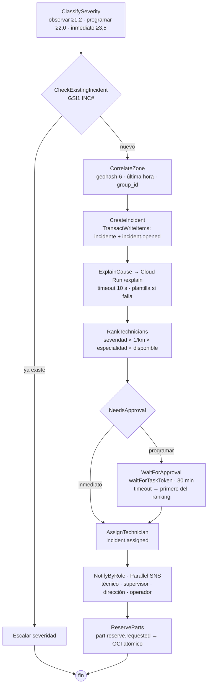
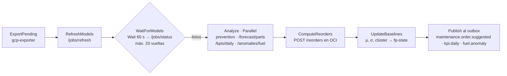

# Arquitectura de la solución


Fuente editable: `architecture.drawio` (abrir en [app.diagrams.net](https://app.diagrams.net) o en draw.io desktop). Para regenerar el PNG después de editar:

```bash
drawio -x -f png -s 2 -b 20 -o docs/architecture.png docs/architecture.drawio
```

## En una frase

AWS es el hub: recibe la telemetría, detecta anomalías y orquesta incidentes. OCI es el sistema de registro (incidentes, repuestos, stock, órdenes) y la consola en APEX. GCP guarda el histórico, entrena los modelos en BigQuery ML y explica cada incidente con Gemini. OCI y GCP nunca se hablan entre sí, así que los secretos viven en un solo lugar (AWS Secrets Manager) y hay un solo camino que vigilar.

## Por qué ninguna nube es decorativa

| Nube | Lo que solo ella hace | Si se apaga |
|---|---|---|
| AWS | Ve la telemetría en tiempo real y actúa: abre incidentes, asigna técnicos, notifica | Nada entra ni se decide |
| OCI | Transacciones y joins que DynamoDB maneja mal: stock por ubicación con reservas atómicas, órdenes, BOM, historial máquina–incidente–repuesto; consola del responsable de mantenimiento | Los eventos esperan en SQS (4 días) y se aplican al volver; OCI se reconstruye desde S3 |
| GCP | Memoria larga: 30 días de historia, clústeres de pares, pronósticos, anomalías de combustible, IA generativa | AWS sigue detectando; los incidentes salen con explicación por plantilla |

## Flujo de eventos

1. `simulator` (Lambda, cada minuto, `TIME_WARP=5`) envía lotes de 10 lecturas por máquina a `POST /telemetry` con API key.
2. `ingest` valida contra `contracts/telemetry-batch.schema.json`, escribe la lectura y actualiza estado y posición en `fp-state`.
3. El stream de `fp-state` alimenta a `score` (anomalías) y `archiver` (NDJSON gzip en `s3://fp-raw/telemetry/dt=/hr=/`).
4. Con score ≥ 2,0, `score` inicia `incident-flow` con nombre `<machine_id>-<ventana 15 min>`: Step Functions rechaza nombres repetidos, así que no hay incidentes duplicados.
5. `incident-flow` clasifica, correlaciona por zona, crea el incidente y escribe en `fp-outbox` (misma transacción), pide la explicación a Cloud Run `/explain`, rankea técnicos, espera aprobación si corresponde, asigna, notifica por rol y reserva repuestos.
6. El stream de `fp-outbox` publica en SNS `fp-domain-events` → `oci-writer-q` y `gcp-events-q`, cada una con DLQ.
7. `oci-writer` envía cada evento a ORDS `POST /events`; `PROCESSED_EVENTS` rechaza `event_id` repetidos.
8. `snapshot-publisher` (cada 2 min) manda a OCI las máquinas que cambiaron; eso alimenta el mapa de APEX.
9. `gcp-exporter` (cada hora) sube los NDJSON a `gs://fp-landing/` y lanza un load job a BigQuery. Marca de agua en `fp-state`.
10. `daily-planning` (05:00 Lima) pide a Cloud Run refrescar modelos, pronosticar repuestos y calcular KPIs; los resultados vuelven por el outbox a OCI.
11. El correo de aprobación llama a `POST /approvals/{token}` (`SendTaskSuccess`); el botón Cerrar de APEX llama a `POST /incidents/{id}/close`. AWS es el único que cambia el estado de un incidente.

### incident-flow (Standard)



### daily-planning (Standard)



Ambas: reintento con backoff exponencial (3 intentos, base 2 s) en cada Lambda, `Catch` global que publica en `fp-alerts`, logs con `includeExecutionData`. Standard y no Express porque Express no soporta `waitForTaskToken` ni guarda el historial visual.

## Comunicación entre nubes

| Origen → destino | Protocolo | Autenticación | Secreto (Secrets Manager) | Si falla |
|---|---|---|---|---|
| AWS → OCI (ORDS) | HTTPS REST JSON | OAuth2 client credentials, token cacheado 50 min | `fleetpulse/oci/ords` | SQS reintenta (visibilidad 60 s); 5 intentos → DLQ; retención 4 días |
| AWS → Cloud Storage y BigQuery | Subida reanudable + load job | Llave JSON de la SA `fp-exporter` | `fleetpulse/gcp/sa-exporter` | Marca de agua por hora; dedupe por `batch_id` |
| AWS → Cloud Run | HTTPS | ID token firmado por la SA `fp-invoker` (`roles/run.invoker`) | `fleetpulse/gcp/sa-invoker` | Timeout 8 s → explicación por plantilla; nunca bloquea |
| Cloud Run → Gemini | HTTPS | API key | GCP Secret Manager `gemini-api-key` | 1 reintento; 429 → plantilla |
| Cloud Run → BigQuery | Cliente oficial | SA de ejecución `fp-insights` (dataViewer, jobUser) | — | `maximumBytesBilled` 1 GB |
| Correo / APEX → AWS | HTTPS a API Gateway | Task token de un solo uso / API key en Web Credential | `fleetpulse/api/ingest-key` | Token expira con el paso (30 min) |

Los cuatro secretos se leen en el arranque en frío con caché de 5 minutos. Nunca van en variables de entorno, en el repo ni en los logs. `scripts/push-secrets.sh` los carga desde las salidas de Terraform y del `OAUTH.CREATE_CLIENT` de ORDS.

## Modelo de datos: un dueño por dato

| Dato | Dueño | Por qué ahí |
|---|---|---|
| Estado actual, últimas lecturas (3 d), scores, incidentes activos, técnicos, baselines, marca de agua | DynamoDB `fp-state` (single-table, GSI1 por zona) | Acceso por clave, stream para reaccionar, multi-AZ |
| Telemetría cruda y eventos de dominio | S3 `fp-raw` (versionado) | Fuente de verdad para reprocesar hacia OCI o GCP |
| Incidentes, eventos, órdenes, repuestos, stock, reservas, KPIs | Autonomous Database, esquema `FLEET` | Transacciones (`reserved ≤ on_hand`), joins, APEX |
| Histórico completo, vistas, modelos | BigQuery `fleetpulse` (particionado por día, clúster por máquina y zona) | Entrena sin mover datos; cargas gratis |

La telemetría nunca entra a OCI: 20 GB de Always Free alcanzan incluso con 10.000 máquinas.

## Buenas prácticas por nube

### AWS Well-Architected

| Pilar | Decisiones | Dónde se ve |
|---|---|---|
| Excelencia operativa | Todo como código (Serverless Framework, Terraform, SQL versionado). CI con gitleaks, lint, tests, `sls package`, `terraform validate` y validación de contratos JSON Schema. `incident_id` y `batch_id` como ID de correlación en los logs de las 3 nubes. Alarmas por DLQ > 0 y ejecuciones fallidas | `.github/workflows/`, `contracts/`, CloudWatch |
| Seguridad | Secretos de OCI y GCP en Secrets Manager (cifrados con `aws/secretsmanager`), caché 5 min, nunca en env ni logs. API keys y throttling en API Gateway. Cifrado en reposo en las 3 nubes y TLS en tránsito. Ningún bucket público. Task token de un solo uso para aprobaciones | Secrets Manager, API Gateway |
| Fiabilidad | Outbox + SNS + SQS + DLQ entre nubes: una caída remota no tumba el flujo. Idempotencia en cada salto: nombre de ejecución, `fp-inbox`, `PROCESSED_EVENTS`, `batch_id`. Timeouts con alternativa (Gemini → plantilla). Reproceso desde S3 (`replay-oci.py`). Modo degradado documentado por nube | `aws/integrations/`, `aws/shared/lib/` |
| Eficiencia de rendimiento | Ingesta por lotes de 10. Step Functions solo por incidente, no por lectura. Lambda arm64. DynamoDB single-table con GSI por zona y TTL. ORDS agrupa conexiones. BigQuery particionado y en clústeres. Cloud Run con concurrencia 80 | Tablas, `serverless.yml` |
| Optimización de costos | Todo escala a cero. DynamoDB on-demand, TTL 3 d en lecturas. S3 a Glacier IR a 90 d. Logs 14 d. Niveles gratuitos de OCI y GCP; sin load balancer; load jobs y no streaming; `require_partition_filter`, `maximumBytesBilled`, cuota diaria de 30 GB. Simulador apagado fuera de pruebas | Sección de costos del README |
| Sostenibilidad | Solo se procesa lo que cambia (streams, snapshot de deltas). NDJSON comprimido. arm64. Ningún recurso encendido en reposo | Lifecycle de S3, `archiver` |

### Google Cloud Architecture Framework

| Pilar | Decisiones |
|---|---|
| Diseño del sistema | Región única `us-east1` (Cloud Storage gratis), BigQuery multirregión US. Un solo servicio Cloud Run con varios endpoints: menos superficie, menos arranques en frío |
| Excelencia operativa | Terraform para APIs, bucket, dataset, tablas, SAs, Secret Manager, Artifact Registry (política de 2 imágenes). Vistas y modelos como SQL versionado en `gcp/bq/`. `/health` para el smoke test |
| Seguridad, privacidad y cumplimiento | Tres service accounts con un rol cada una (`fp-exporter`, `fp-invoker`, `fp-insights`). Cloud Run no público: requiere ID token con `roles/run.invoker`. Llave de Gemini en Secret Manager, no en la imagen. Solo datos simulados hacia Gemini |
| Fiabilidad | Cloud Run sin estado y multizona. BigQuery con time travel 7 d y recarga desde S3. Load jobs idempotentes por `batch_id`. Degradación: si `/explain` falla, AWS sigue |
| Optimización de costos | Capa gratuita permanente: 1 TB de consultas y 10 GB al mes, 2 M de solicitudes de Cloud Run, 5 GB de Storage. Guardas duras: cuota diaria de BigQuery, `maximumBytesBilled`, `require_partition_filter`, lifecycle 3 d en `fp-landing`, Cloud Run min 0 / max 2 / 512 MiB / CPU solo durante la solicitud. Prohibido: Vertex AI, Compute Engine, Cloud SQL, load balancers, Cloud NAT, streaming inserts |
| Optimización de rendimiento | Particiones por `DATE(ts)` y clústeres por `machine_id, zone`. Modelos sobre agregados diarios (megabytes). Una llamada a Gemini por incidente, cacheada; salida estructurada con `response_schema` para no reintentar por formato |

### OCI Best Practices Framework

| Pilar | Decisiones |
|---|---|
| Seguridad y cumplimiento | Escritura solo por ORDS con OAuth2 client credentials; ningún wallet mTLS sale de OCI. Usuario de esquema `FLEET` separado de `ADMIN`. APEX con autenticación de workspace y Web Credential para llamar a AWS. Cifrado en reposo por defecto (TDE) y TLS |
| Fiabilidad y resiliencia | Always Free no tiene Data Guard ni backups manuales: la resiliencia se defiende con el outbox de AWS y `replay-oci.py` desde `s3://fp-raw/events/`. `PROCESSED_EVENTS` hace idempotente cualquier reintento. La base se detiene tras 7 días sin uso: `snapshot-publisher` la mantiene activa durante la hackathon |
| Rendimiento y costo | Autonomous Database Serverless con `is_free_tier = true` (20 GB, 1 OCPU, ORDS y APEX incluidos). Límite de 20 sesiones → pool de conexiones en ORDS, nunca driver desde Lambda. Reserva de stock en un solo `UPDATE` condicional. Sin Compute ni Object Storage: costo USD 0 |
| Eficiencia operativa | Terraform para la base; esquema, paquete PL/SQL, ORDS, OAuth y seed como SQL numerado en `oci/sql/`; export de APEX en `oci/apex/f100.sql`. Todo reproducible con `scripts/oci-sql.sh` |

## Lo que no cumplimos, y se dice en el video

- **Sin autenticación real de usuarios** (Cognito o IDCS). APEX usa el login de su workspace y los roles se simulan. En producción: Cognito con grupos por rol y APEX federado.
- **Sin mínimo privilegio en AWS.** El Learner Lab solo ofrece `LabRole`. En producción: un rol por función con la política exacta.
- **OCI Always Free no tiene alta disponibilidad propia.** La compensamos con el reproceso desde S3. En producción: Autonomous Database de pago con Data Guard (≈ USD 500/mes con 2 ECPU, a validar).
- **Cada nube corre en una sola región.** El crédito y el Learner Lab no justifican multi-región; el diseño no lo impide.

## Costo por escala (on-demand, sin descuentos)

| Máquinas | 100 | 1.000 | 10.000 |
|---|---|---|---|
| USD/mes | ~10 | ~50 | ~475 |

Dominan API Gateway, DynamoDB y Lambda. Con lotes cada 15 minutos en lugar de 5, esos tres rubros bajan a cerca de un tercio. OCI y GCP quedan en USD 0 durante la hackathon.
