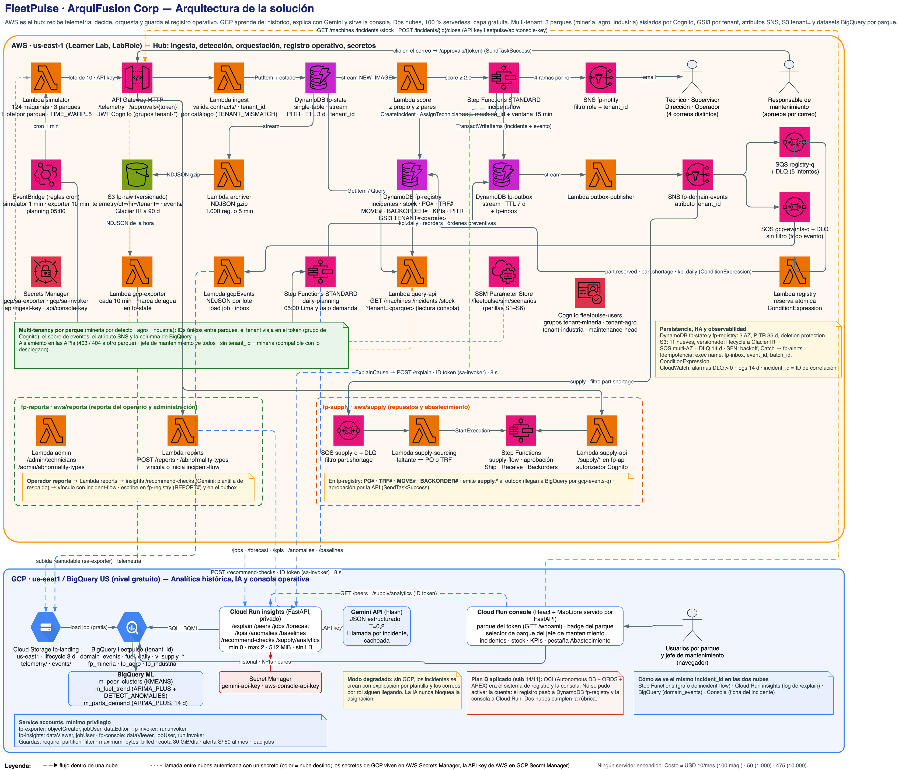
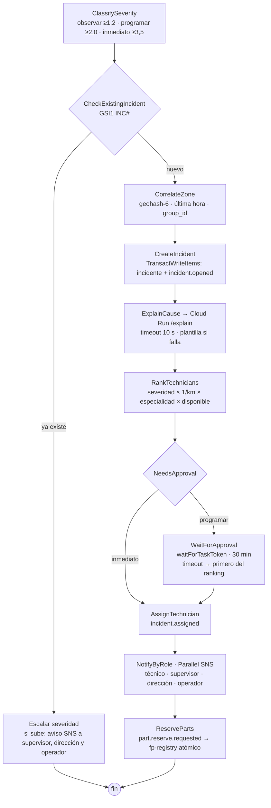
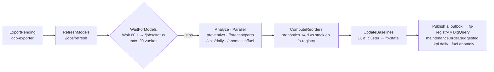

# Arquitectura de la solución



Fuente editable: `architecture.drawio` (abrir en [app.diagrams.net](https://app.diagrams.net) o en draw.io desktop). Para regenerar el PNG después de editar:

```bash
drawio -x -f png -s 2 -b 20 -o docs/architecture.png docs/architecture.drawio
```

## En una frase

AWS es el hub: recibe la telemetría, detecta anomalías, orquesta incidentes y guarda el registro operativo (incidentes, reportes del operario, stock, reservas, órdenes de compra y transferencias). GCP guarda el histórico, entrena los modelos en BigQuery ML, explica cada incidente con Gemini y sirve la consola operativa. Dos nubes, un solo lugar para los secretos de GCP (AWS Secrets Manager) y un solo camino entre nubes que vigilar.

> **Plan B aplicado el sáb 14/11 21:30.** El diseño original tenía OCI (Autonomous Database + ORDS + APEX) como sistema de registro y consola. Ninguno del equipo pudo crear la cuenta, así que se ejecutó el plan B previsto: el esquema relacional pasó a DynamoDB `fp-registry` y la consola a Cloud Run. Con dos nubes se sigue cumpliendo la rúbrica.

## Multi-tenancy por parque

FleetPulse atiende tres parques (tenants) separados: `mineria` (Operación Cerro Azul, el parque por defecto), `agro` (Fundo Valle Sur) e `industria` (Planta Lurín). Cada uno tiene sus máquinas, zonas, técnicos y stock; el administrador de un parque solo ve y gestiona el suyo, y el **jefe de mantenimiento** (`maintenance_head`) ve todos. Diseño completo: repo `backlog`, `docs/superpowers/plans/2026-11-15-multi-tenancy.md`.

| Capa | Recurso por parque | Dónde |
|---|---|---|
| Identidad | Grupos de Cognito `tenant-mineria`, `tenant-agro`, `tenant-industria` y `maintenance-head`; el ID token los trae en `cognito:groups` | `aws/auth/serverless.yml`, `scripts/cognito-seed.sh` |
| Autorización | `fplib.authz.tenant_of/scope/require_tenant_access`: otro parque = 403 (listado) o 404 (recurso) | `aws/shared/python/fplib/authz.py` |
| Configuración | SSM `/fleetpulse/tenants` y `/fleetpulse/tenants/<parque>` | `aws/auth/serverless.yml` |
| Datos | `tenant_id` en cada ítem y **GSI3** `TENANT#<parque>` en `fp-registry` (incidentes y reportes); stock por zona, y las zonas son de un parque | `aws/ingest/serverless.yml` |
| Eventos | Sobre con `tenant_id`; atributo SNS `tenant_id` en `fp-domain-events` y `fp-notify` (suscripciones con `FilterPolicy {role, tenant_id}`) | `outbox-publisher`, `incident-flow.asl.json`, `scripts/subscribe-notify.sh` |
| Crudo | `s3://fp-raw/telemetry/dt=/hr=/tenant=<parque>/` | `aws/ingest/consumidores/archiver.py` |
| Analítica | Columna `tenant_id` en BigQuery y datasets `fp_mineria`, `fp_agro`, `fp_industria` con vistas autorizadas filtradas por parque | `gcp/terraform/tenants.tf` |
| Consola | El BFF saca el parque del token (`GET /whoami`) y pasa `?tenant=` a la API de lectura; badge del parque y selector para el jefe de mantenimiento | `gcp/console/` |

Los IDs de negocio son únicos entre parques (prefijos de modelo `TA/CS` en agro y `MC/CP/GE` en industria, zonas y técnicos propios), así que las claves de DynamoDB no cambian: el parque de cualquier dato viejo se deduce del catálogo (`contracts/tenants.yaml`) y todo lo que no trae `tenant_id` es de `mineria`. El aislamiento lo imponen las APIs y no IAM porque el Learner Lab solo ofrece `LabRole`.

## Por qué ninguna nube es decorativa

| Nube | Lo que solo ella hace | Si se apaga |
|---|---|---|
| AWS | Ve la telemetría en tiempo real y actúa: abre incidentes, asigna técnicos, reserva repuestos, notifica. Es el único que cambia el estado de un incidente | Nada entra ni se decide |
| GCP | Memoria larga: 30 días de historia, clústeres de pares, pronósticos, anomalías de combustible, IA generativa; y la consola que usan el responsable de mantenimiento y los técnicos | AWS sigue detectando y notificando por correo; los incidentes salen con explicación por plantilla y la consola no está disponible |

## Flujo de eventos

1. `simulator` (Lambda, cada minuto, `TIME_WARP=5`) envía un lote por parque con 10 lecturas por máquina a `POST /telemetry` con API key; `ingest` fija el `tenant_id` de cada lectura por catálogo y rechaza un lote con máquinas de otro parque.
2. `ingest` valida contra `contracts/telemetry-batch.schema.json`, escribe la lectura y actualiza estado y posición en `fp-state`.
3. El stream de `fp-state` alimenta a `score` (anomalías) y `archiver` (NDJSON gzip en `s3://fp-raw/telemetry/dt=/hr=/`).
4. Con score ≥ 2,0, `score` inicia `incident-flow` con nombre `<machine_id>-<ventana 15 min>`: Step Functions rechaza nombres repetidos, así que no hay incidentes duplicados.
5. `incident-flow` clasifica, correlaciona por zona, crea el incidente en `fp-registry` y el evento en `fp-outbox` (misma transacción), pide la explicación a Cloud Run `/explain`, rankea técnicos, espera aprobación si corresponde, asigna, notifica por rol y pide la reserva de repuestos.
6. El stream de `fp-outbox` publica en SNS `fp-domain-events` → `registry-q`, `gcp-events-q` y `supply-q` (esta última solo con `part.shortage`), cada una con DLQ.
7. La Lambda `registry` aplica los eventos en `fp-registry`: la reserva es un `UpdateItem` con `ConditionExpression on_hand - reserved >= :qty`; si falla prueba la zona más cercana y, si no hay, escribe un pedido sugerido y emite `part.shortage`. `fp-inbox` rechaza `event_id` repetidos.
8. `gcp-exporter` (cada 10 min) sube cada hora cerrada de telemetría de `s3://fp-raw/telemetry/` a `gs://fp-landing/` y lanza un load job a `telemetry` (marca de agua en `fp-state`). La Lambda `gcpEvents` (misma pila, `fp-gcp-exporter`) consume `gcp-events-q` sin filtro en lotes de hasta 100 / 60 s: un NDJSON gzip en `gs://fp-landing/events/` y un load job `WRITE_APPEND` a `domain_events` por lote, nunca streaming. Idempotencia con `fp-inbox` (`gcp-events:<event_id>`); `scripts/backfill_domain_events.py` carga los `EV#` previos de `fp-registry` con el mismo código.
9. `supply-sourcing` (Lambda sobre `supply-q`) convierte cada `part.shortage` en una sugerencia de orden de compra (`PO#`) o transferencia (`TRF#`) e inicia `supply-flow`. Ver [Abastecimiento](#abastecimiento-fp-supply).
10. `daily-planning` (05:00 Lima) pide a Cloud Run refrescar modelos, pronosticar repuestos y calcular KPIs; los resultados vuelven por el outbox a `fp-registry`.
11. La consola (Cloud Run `console`: React + MapLibre compilado a estáticos y servido por FastAPI) lee el estado en vivo a través de su backend `/api/*`, que llama a la API de lectura de AWS (`GET /machines`, `/incidents`, `/stock`, API key en Secret Manager) y a BigQuery para historial y KPIs; refresca cada 15 s. Tiene pestaña Abastecimiento (`/api/supply/*`) y los reportes del operario.
12. El correo de aprobación llama a `POST /approvals/{token}` (`SendTaskSuccess`); el botón Cerrar de la consola llama, vía el backend, a `POST /incidents/{id}/close`. AWS es el único que cambia el estado de un incidente.

### Abastecimiento (`fp-supply`)

Cierra el ciclo faltante → opción → aprobación → despacho → recepción → reserva para el incidente que esperaba. Stack `fp-supply` en `aws/supply`. Diseño: repo `backlog`, `docs/superpowers/plans/2026-11-15-repuestos-abastecimiento.md`.

| Pieza | Recurso | Detalle |
|---|---|---|
| Entrada | SNS `fp-domain-events` → SQS `supply-q` + `supply-dlq` | Filtro `event_type = part.shortage`; 5 intentos; alarma `fp-supply-dlq-not-empty` |
| Sourcing | Lambda `supply-sourcing` (`supply/consumer.py`) | Evalúa transferir desde otro almacén u ordenar a proveedor; crea `PO#` o `TRF#` y empieza `supply-flow` con el id como nombre (sin duplicados) |
| Orquestación | Step Functions Standard `supply-flow` | Aprobación por la API (`WaitForApproval`, task token), `PlaceOrder` (PO) o `Ship` (TRF), `WaitForReceipt`, `Receive`, `AllocateBackorders`; notificación por `fp-notify`, fallos a `fp-alerts` |
| API | `/supply/*` en la HTTP API `fp-api` | Autorizador Cognito por id (salida `HttpApiAuthorizerCognitoId` de `fp-core`): stock, sugerencias, proveedores, movimientos, KPIs, órdenes y transferencias (crear, aprobar, rechazar, recibir) |
| Datos | `fp-registry` | `PO#`, `TRF#`, `MOVE#`, `BACKORDER#`; amplía `STOCK#` con `on_order`, `in_transit` |
| Eventos | Outbox → `fp-domain-events` | `supply.suggested`, `supply.approved`, `supply.cancelled`, `po.ordered`, `transfer.shipped`, `supply.received` (`contracts/supply.schema.json`) |
| Analítica | GCP | Vistas `v_supply_orders` y `v_stockouts_daily` sobre `domain_events`; insights `GET /supply/analytics` |
| Consola | Pestaña Abastecimiento | Stock por parque, sugerencias con opciones, órdenes y transferencias con recepción |

La recepción reserva sola el repuesto para el incidente que lo esperaba (`AllocateBackorders`) y borra el `BACKORDER#`. Los eventos `supply.*` llegan a BigQuery por `gcp-events-q`, sin tocar el exporter.

### Reportes del operario (`fp-reports`)

Stack `fp-reports` en `aws/reports`, en la misma HTTP API `fp-api`, todo con el autorizador Cognito.

1. El operador envía `POST /reports`. La Lambda `reports` cruza la telemetría reciente con la ficha del fabricante.
2. Pide los chequeos a insights `POST /recommend-checks` (Gemini) con el ID token de la SA `fp-invoker`, timeout 8 s. Si falla, usa la plantilla de respaldo del catálogo.
3. Vincula el incidente abierto de la máquina o inicia `incident-flow`, y escribe el reporte, su línea de tiempo y `report.created` en una transacción.
4. El técnico asignado ve los chequeos y cierra con `POST /reports/{id}/close`.

La Lambda `admin` del mismo stack sirve las rutas de administración (solo rol `admin`): `/admin/technicians` y `/admin/abnormality-types`.

### Capa 1: score en línea (Lambda `score`)

Solo lecturas `operating` (ralentí y apagado tienen otra física; un lote sin ellas no se puntúa). Para cada variable, `z` es el de mayor |z| entre la línea base propia y la de pares:

```text
score = Σ_v w_v · max(0, |z_v| − 2,25) + 0,5 · #{v : |z_v| ≥ 2,25 y sube 3 lotes seguidos}
```

- Pesos: presión hidráulica y vibración 1,0; temperaturas 0,9; combustible 0,8; rpm 0,5. Umbrales sin cambio: observar ≥ 1,2; programar ≥ 2,0; inmediato ≥ 3,5.
- Banda muerta de 2,25σ (`score.DEADBAND`): la fórmula original sumaba seis |z| y un lote sano quedaba en ~2,2 (sobre programar); con la banda, el ruido sano aporta 0.
- Línea base propia (μ, σ por variable) sembrada con `scripts/seed-baselines.py`: 24 h de historia del simulador (determinista), un lote por minuto. Respaldo si falta: arranque en frío con ≥ 200 lecturas `operating` y σ ≥ 5 % de |μ|.
- Calibración (`FP_CALIBRATION=1`, replay del simulador real, 100 máquinas; objetivo ≤ 1 falsa alarma/día). Banda 2,0: 0 en 2 h pero 3 lotes/día en 24 h, empujados por la tendencia. Banda 2,25 (la elegida): 0 en 24 h; S1 cruza programar en 5-11 min con EX-017 operando, siempre como `hydraulic_pump`; S2 detectado en las 4 máquinas como `fuel_contamination` en 10-13 min. Si cambia la física del simulador: resembrar y recalibrar.

### incident-flow (Standard)



### daily-planning (Standard)



Ambas: reintento con backoff exponencial (3 intentos, base 2 s) en cada Lambda, `Catch` global que publica en `fp-alerts`, logs con `includeExecutionData`. Standard y no Express porque Express no soporta `waitForTaskToken` ni guarda el historial visual.

## Stacks y colas

Se despliegan con `aws/serverless-compose.yml` (el CI de GitHub Actions usa los secretos del Learner Lab).

| Stack | Carpeta | Contiene |
|---|---|---|
| `fp-shared` | `aws/shared` | Capa `fp-shared` (`fplib`, `jsonschema`, `google-auth`, contratos) |
| `fp-auth` | `aws/auth` | Cognito `fleetpulse-users`, grupos por parque y `maintenance-head` |
| `fp-core` | `aws/ingest` | HTTP API `fp-api`, tablas `fp-state`, `fp-registry`, `fp-outbox`, `fp-inbox`, S3 `fp-raw`, topics SNS, `ingest`, `archiver`, `query-api` |
| `fp-outbox-publisher` | `aws/integrations/outbox-publisher` | Stream de `fp-outbox` → `fp-domain-events` |
| `fp-registry` | `aws/registry` | `registry-q` y Lambdas `registry` y API de lectura |
| `fp-gcp-exporter` | `aws/integrations/gcp-exporter` | `exporter` (cada 10 min) y `gcpEvents` con `gcp-events-q` |
| `fp-incidents` | `aws/incidents` | `incident-flow` |
| `fp-scoring` | `aws/scoring` | Lambda `score` |
| `fp-reports` | `aws/reports` | Reportes del operario y administración |
| `fp-planning` | `aws/planning` | `daily-planning` (regla diaria apagada por defecto) |
| `fp-supply` | `aws/supply` | `supply-q`, `supply-sourcing`, `supply-flow`, API `/supply/*` |
| `fp-simulator` | `simulator` | Lambda `simulator` (apagado fuera de pruebas) |

| Cola | Suscrita a | Filtro | Consumidor | DLQ |
|---|---|---|---|---|
| `registry-q` | `fp-domain-events` | — | Lambda `registry` | `registry-dlq` |
| `gcp-events-q` | `fp-domain-events` | ninguno | Lambda `gcpEvents` (lotes de 100 / 60 s) | `gcp-events-dlq` |
| `supply-q` | `fp-domain-events` | `event_type = part.shortage` | Lambda `supply-sourcing` (lotes de 5 / 5 s) | `supply-dlq` |

Cada DLQ tiene alarma `ApproximateNumberOfMessagesVisible > 0` hacia `fp-alerts`.

## Comunicación entre nubes

| Origen → destino | Protocolo | Autenticación | Secreto (Secrets Manager) | Si falla |
|---|---|---|---|---|
| AWS → Cloud Storage y BigQuery | Subida reanudable + load job | Llave JSON de la SA `fp-exporter` | `fleetpulse/gcp/sa-exporter` | `exporter`: marca de agua por hora, dedupe por `batch_id`. `gcpEvents`: el lote vuelve a la cola y tras 5 intentos va a `gcp-events-dlq` |
| AWS → Cloud Run (insights, privado) | HTTPS: `/explain`, `/recommend-checks`, `/jobs`, `/forecast`, `/kpis` | ID token firmado por la SA `fp-invoker` (`roles/run.invoker`); AWS lo pide con la llave guardada en el secreto (`fplib.gcp_auth`, caché 50 min) | `fleetpulse/gcp/sa-invoker` (`{key, audience}`) | Timeout 8 s → explicación o chequeos por plantilla; nunca bloquea |
| Cloud Run → Gemini | HTTPS | API key | GCP Secret Manager `gemini-api-key` | 1 reintento; 429 → plantilla |
| Cloud Run → BigQuery | Cliente oficial | SA de ejecución `fp-insights` (dataEditor del dataset para reentrenar modelos, jobUser) | — | `maximum_bytes_billed` en cada consulta y job |
| Consola (Cloud Run, backend) → AWS | HTTPS a API Gateway | API key (`fleetpulse/api/console-key`), copia en GCP Secret Manager `aws-console-api-key`; nunca llega al navegador | `fleetpulse/api/console-key` | La consola muestra el último estado leído y avisa que está desactualizado |
| Correo → AWS | HTTPS a API Gateway | Task token de un solo uso en la URL | — | Token expira con el paso (30 min) |

Los secretos se leen en el arranque en frío con caché de 5 minutos. Nunca van en variables de entorno, en el repo ni en los logs. Las API keys `fleetpulse/api/*` las genera el stack fp-core (un solo dueño); `scripts/push-secrets.sh` carga las llaves de GCP desde las salidas de Terraform. Un rechazo de API key se loguea con su motivo (`missing_header`, `secret_unavailable:<tipo>`, `mismatch`), nunca con la llave.

## Modelo de datos: un dueño por dato

| Dato | Dueño | Por qué ahí |
|---|---|---|
| Estado actual, últimas lecturas (3 d), scores, incidentes activos, técnicos, baselines, marca de agua | DynamoDB `fp-state` (single-table, GSI1 por zona) | Acceso por clave, stream para reaccionar, multi-AZ |
| Telemetría cruda | S3 `fp-raw` (versionado) | Fuente de verdad para reprocesar hacia BigQuery |
| Incidentes y su línea de tiempo, reportes del operario, catálogo de anormalidades, órdenes de mantenimiento, BOM, stock por zona, reservas, pedidos sugeridos (`REORDER#`), órdenes de compra (`PO#`), transferencias (`TRF#`), movimientos de stock (`MOVE#`), pendientes de entrega (`BACKORDER#`), KPIs | DynamoDB `fp-registry` (single-table, PITR, stream) | Reserva y despacho atómicos con `ConditionExpression`; lectura por clave para la consola; los joins pesados (historial, KPIs) se hacen en BigQuery |
| Eventos de dominio | DynamoDB `fp-outbox` → BigQuery `domain_events` (un load job `WRITE_APPEND` por lote de `gcpEvents`) | Una sola lectura del outbox; la analítica no consulta `fp-registry` |
| Histórico completo, vistas, modelos | BigQuery `fleetpulse` (particionado por día, clúster por máquina y zona) | Entrena sin mover datos; cargas gratis |
| `fuel_daily` | BigQuery, tabla materializada desde `v_fuel_daily` (`gcp/bq/t_fuel_daily.sql`, ~11 mil filas) | `m_fuel_trend` (ARIMA_PLUS) vuelve a leer su entrada varias veces; sobre la vista re-escaneaba toda `telemetry` y pasaba el tope de bytes. Un `CREATE TABLE AS SELECT` puntual, no streaming |
| Vistas de abastecimiento | BigQuery `v_supply_orders`, `v_stockouts_daily` (desde `domain_events`) | Estado de cada PO/TRF y quiebres de stock; las sirve insights `/supply/analytics` |

La telemetría nunca entra a `fp-registry`: el registro guarda decisiones, no lecturas.

## Costos y guardas

| Guarda | Dónde | Qué hace |
|---|---|---|
| Alerta de presupuesto `fleetpulse-creditos-consumo` | GCP (Billing) | S/ 900 al mes **sin descontar créditos** (≈ el crédito restante del Free Trial el 15 nov); avisos al 25, 50, 75, 90 y 100 % del gasto y al 90 % por pronóstico. Avisa, no corta |
| `maximum_bytes_billed` | Toda consulta y job de BigQuery (`gcp/insights/app/bq.py`, `analytics.py`, `supply.py`, `gcp/bq/apply_models.sh`) | Un job que escanearía más del tope falla en vez de cobrar |
| Tope de 30 GiB al día | Cuota de consultas del proyecto BigQuery | Techo duro diario aunque falle una guarda por consulta |
| `require_partition_filter`, load jobs | Tablas de BigQuery | Sin escaneos completos; nunca streaming |
| `fuel_daily` | BigQuery | Entrena `m_fuel_trend` sobre ~11 mil filas, no sobre `telemetry` |

GCP sigue en Free Trial sin upgrade: nada de Vertex AI, Compute Engine, Cloud SQL ni load balancers.

## Lecciones operativas (Learner Lab y despliegue)

| Síntoma | Causa | Mitigación |
|---|---|---|
| Los eventos dejan de procesarse: `registry-q`, `gcp-events-q` o `supply-q` se llenan y no hay errores en las Lambdas | Al vencer la sesión del Learner Lab, los disparadores quedan **Disabled** | Al reiniciar el laboratorio, revisar los 6 event source mappings: 3 de SQS (`registry-q`, `gcp-events-q`, `supply-q`) y 3 de streams (`fp-state` hacia `archiver`, `fp-state` hacia `score`, `fp-outbox` hacia `outbox-publisher`). Habilitar los que estén apagados |
| `supply-flow` pierde `$.id` después de `PlaceOrder` o `Ship` (el estado queda reemplazado por la respuesta de SNS) | Serverless borra las claves `null` del ASL cargado con `${file()}`, así que `"ResultPath": null` desaparece en el despliegue | No usar `"ResultPath": null`; descartar el resultado con una ruta (por ejemplo `$.notified`). `aws/supply/tests/test_supply_template.py` falla si el ASL trae algún `null` |
| El enlace del correo de aprobación responde error en `/approvals/{token}` | API Gateway colapsa `//` en la ruta y el task token (base64 estándar) puede traer `/` | El task token va en base64 url-safe (sin `/` ni `+`) en el enlace; la Lambda lo decodifica. Cubierto en `aws/incidents/tests/test_api.py` |
| En la Mac, `pytest` falla al importar `jsonschema` u otras dependencias de la capa | La capa `aws/shared/python` se construye para Linux arm64 (`manylinux2014_aarch64`) y trae binarios que la Mac no carga | Instalar `jsonschema` en el entorno local para correr los tests; la capa solo se usa en Lambda. No desplegar desde la Mac: despliega el CI con los secretos del Learner Lab |

## Buenas prácticas por nube

### AWS Well-Architected

| Pilar | Decisiones | Dónde se ve |
|---|---|---|
| Excelencia operativa | Todo como código (Serverless Framework, Terraform, SQL versionado). CI con gitleaks, lint, tests, `sls package`, `terraform validate` y validación de contratos JSON Schema. `incident_id` y `batch_id` como ID de correlación en los logs de las 3 nubes. Alarmas por DLQ > 0 y ejecuciones fallidas | `.github/workflows/`, `contracts/`, CloudWatch |
| Seguridad | Secretos de GCP y API keys en Secrets Manager (cifrados con `aws/secretsmanager`), caché 5 min, nunca en env ni logs. API keys y throttling en API Gateway. Cifrado en reposo en las dos nubes y TLS en tránsito. Ningún bucket público. Task token de un solo uso para aprobaciones | Secrets Manager, API Gateway |
| Fiabilidad | Outbox + SNS + SQS + DLQ entre nubes: una caída remota no tumba el flujo. Idempotencia en cada salto: nombre de ejecución, `fp-inbox`, `batch_id`, `ConditionExpression`. Timeouts con alternativa (Gemini → plantilla). `fp-registry` con PITR; los `EV#` se recargan a BigQuery con `scripts/backfill_domain_events.py`. Modo degradado documentado por nube | `aws/integrations/`, `aws/registry/`, `aws/shared/lib/` |
| Eficiencia de rendimiento | Ingesta por lotes de 10. Step Functions solo por incidente, no por lectura. Lambda arm64. DynamoDB single-table con GSI por zona y TTL. BigQuery particionado y en clústeres. Cloud Run con concurrencia 80 | Tablas, `serverless.yml` |
| Optimización de costos | Todo escala a cero. DynamoDB on-demand, TTL 3 d en lecturas. S3 a Glacier IR a 90 d. Logs 14 d. Nivel gratuito de GCP; sin load balancer; load jobs y no streaming; `require_partition_filter`, `maximum_bytes_billed`, cuota diaria de 30 GiB. Simulador apagado fuera de pruebas | Sección de costos del README |
| Sostenibilidad | Solo se procesa lo que cambia (streams, snapshot de deltas). NDJSON comprimido. arm64. Ningún recurso encendido en reposo | Lifecycle de S3, `archiver` |

### Google Cloud Architecture Framework

| Pilar | Decisiones |
|---|---|
| Diseño del sistema | Región única `us-east1` (Cloud Storage gratis), BigQuery multirregión US. Dos servicios Cloud Run con responsabilidades separadas: `insights` (IA y analítica, privado) y `console` (React servido por FastAPI, que también es el backend de la UI) |
| Excelencia operativa | Terraform para APIs, bucket, dataset, tablas, SAs, Secret Manager, Artifact Registry (política de 2 imágenes). Vistas y modelos como SQL versionado en `gcp/bq/`. `/health` para el smoke test |
| Seguridad, privacidad y cumplimiento | Service accounts con un rol cada una (`fp-exporter`, `fp-invoker`, `fp-insights`, `fp-console`). `insights` no público: requiere ID token con `roles/run.invoker`. Llave de Gemini y API key de AWS en Secret Manager, no en la imagen ni en el bundle de React. Solo datos simulados hacia Gemini |
| Fiabilidad | Cloud Run sin estado y multizona. BigQuery con time travel 7 d y recarga desde S3. Load jobs idempotentes por `batch_id`. Degradación: si `/explain` falla, AWS sigue; si la consola cae, los correos por rol siguen llegando |
| Optimización de costos | Capa gratuita permanente: 1 TB de consultas y 10 GB al mes, 2 M de solicitudes de Cloud Run, 5 GB de Storage. Guardas duras: cuota diaria de BigQuery (30 GiB por día en el proyecto), `maximum_bytes_billed` en todas las consultas y jobs, `require_partition_filter`, lifecycle 3 d en `fp-landing`, Cloud Run min 0 / max 2 / 512 MiB / CPU solo durante la solicitud. Prohibido: Vertex AI, Compute Engine, Cloud SQL, load balancers, Cloud NAT, streaming inserts |
| Optimización de rendimiento | Particiones por `DATE(ts)` y clústeres por `machine_id, zone`. Modelos sobre agregados diarios (megabytes). Una llamada a Gemini por incidente, cacheada; salida estructurada con `response_schema` para no reintentar por formato |

## Lo que no cumplimos, y se dice en el video

- **Sin mínimo privilegio en AWS.** El Learner Lab solo ofrece `LabRole`. En producción: un rol por función con la política exacta, y aislamiento por parque también en IAM (`dynamodb:LeadingKeys`, roles por grupo de Cognito con Identity Pool).
- **Multi-tenancy en la capa de aplicación.** Las tablas, el bucket y los topics son compartidos por los parques; el aislamiento lo imponen el autorizador JWT, `fplib.authz` y el BFF. Una sola API key de ingesta para los tres parques (el parque se valida contra el catálogo).
- **Solo dos nubes.** OCI estaba diseñada como sistema de registro relacional; al no poder activarse, el registro vive en DynamoDB. Las consultas con joins (historial, KPIs) se resuelven en BigQuery en lugar de SQL transaccional.
- **Cada nube corre en una sola región.** El crédito y el Learner Lab no justifican multi-región; el diseño no lo impide.

## Costo por escala (on-demand, sin descuentos)

| Máquinas | 100 | 1.000 | 10.000 |
|---|---|---|---|
| USD/mes | ~10 | ~50 | ~475 |

Dominan API Gateway, DynamoDB y Lambda. Con lotes cada 15 minutos en lugar de 5, esos tres rubros bajan a cerca de un tercio. GCP queda en USD 0 durante la hackathon.
