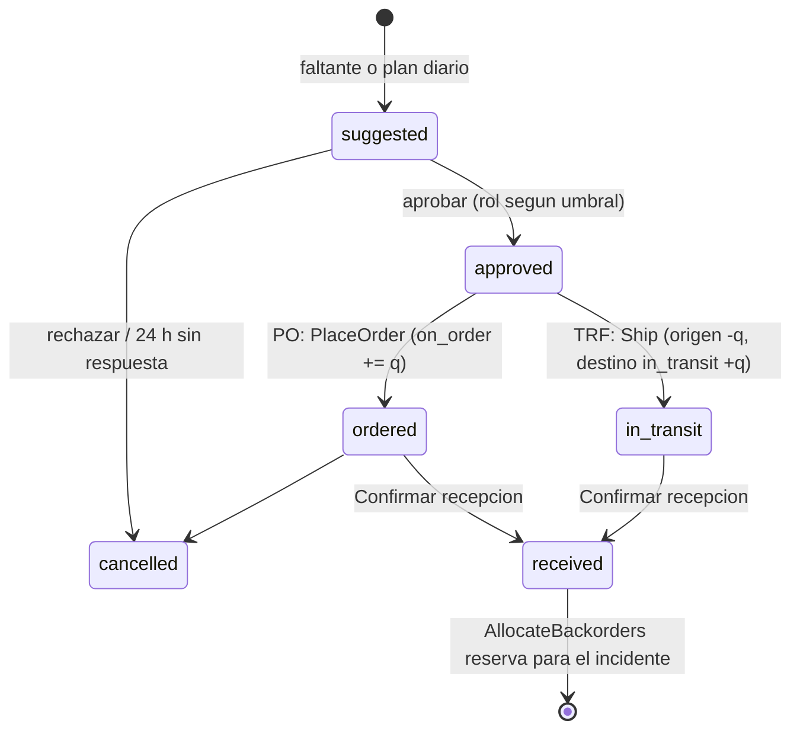
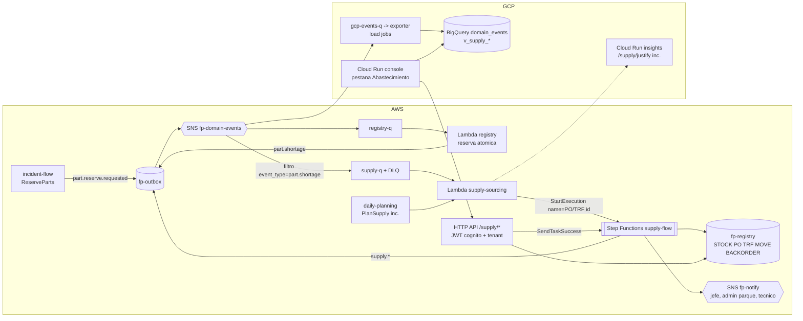

# Módulo de repuestos y abastecimiento (T37-T46)

**Estado:** diseño para revisión (dom 2026-11-15, 03:30 Lima). No hay código todavía; las tareas están en el backlog
con la etiqueta `repuestos`. Se construye **encima** de lo que ya existe (reserva atómica en `aws/registry`,
`ReserveParts` en `incident-flow`, pedidos sugeridos `REORDER#` de `daily-planning`, `parts_used` al cerrar) y no
reemplaza nada de eso.

## 1. El problema y por qué importa en la rúbrica

El problema 3 del documento de diseño ("Distribución de repuestos") es uno de los dolores que el proyecto prometió
resolver. Hoy FleetPulse **reserva** el repuesto al abrir un incidente y, si no hay, deja un `REORDER#` y emite
`part.shortage`. Ahí se corta la historia: nadie decide de dónde sale el repuesto, no hay proveedor, no hay orden de
compra, no hay transferencia entre parques, no hay recepción y el stock solo baja. En una operación real la parada
de una excavadora por una bomba hidráulica cuesta cientos de dólares por hora, y el tiempo de espera del repuesto es
la mayor parte del tiempo detenida.

El módulo cierra el ciclo **faltante → opción de abastecimiento → aprobación → despacho → recepción → reserva para el
incidente que esperaba**, consciente de los parques (multi-tenancy, T36) y con un KPI que se ve: horas de parada
evitadas y su costo.

## 2. Historia de la demo (2:30 del video)

| Tiempo | Qué se ve | Qué se dice | Criterio |
|---|---|---|---|
| 0:00-0:25 | EX-017 (parque `mineria`, zona NORTE) abre incidente `hydraulic_pump`. En la línea de tiempo: `part.reserved` (2 kits de sellos) y `part.shortage` (bomba hidráulica PRT-04: 0 en los 3 almacenes de mina) | "Los sellos estaban; la bomba no" | Problema 3 |
| 0:25-0:55 | Pestaña **Abastecimiento** del jefe de mantenimiento: mapa de calor repuesto × almacén de los 3 parques, PRT-04 en rojo en mina y verde en `agro`. Tarjeta de sugerencia con dos opciones: **transferir 1 desde agro FUNDO-A, llega en 16 h, USD 180 de flete** contra **orden de compra a HidraAndes, 7 días, USD 6.800**. "Evita 152 h de parada ≈ USD 68.400" | "No compramos lo que ya tenemos en otro parque" | Problema 3, multi-tenant |
| 0:55-1:20 | Grafo de Step Functions `supply-flow` detenido en `WaitForApproval`. El jefe aprueba en la consola; el grafo avanza a `Ship` (stock de agro baja, `in_transit` de mina sube) y queda en `WaitForReceipt` | "Cada orden es una máquina de estado con aprobación humana" | Step Functions |
| 1:20-1:50 | Con el rol de admin del parque `mineria`: "Confirmar recepción". El grafo pasa por `Receive` → `AllocateBackorders`: la bomba queda reservada para el incidente de EX-017 y el técnico recibe el correo "tu repuesto llegó" | "La recepción reserva sola el repuesto para quien lo esperaba" | Problemas 3 y 9 |
| 1:50-2:15 | El admin del parque `agro` entra y solo ve su stock y la transferencia saliente; el jefe ve los 3 parques | "Cada parque administra lo suyo; el jefe ve todo" | Seguridad, multi-tenant |
| 2:15-2:30 | Panel de BigQuery en la consola: quiebres de stock por día, días de cobertura por repuesto crítico y "parada evitada" acumulada | "La analítica sale de los mismos eventos" | 2 nubes, persistencia |

Variante si sobra tiempo: la sugerencia sale de `daily-planning` (preventivos a 14 días) sin incidente, con una orden
de compra de filtros que el admin del parque aprueba solo porque está bajo el umbral.

## 3. Interfaz con multi-tenancy (T36)

Se apoya en `docs/superpowers/plans/2026-11-15-multi-tenancy.md` (rama `feat/multi-tenancy`) y no redefine nada de
eso:

- `tenant_id ∈ {mineria, agro, industria}`; lo que no lo trae es `mineria`. Los IDs de negocio son únicos entre
  parques y **el tenant se deduce del catálogo** (zona → parque). El sobre de eventos gana `tenant_id` (lo escribe
  `fplib.envelope.build`) y `outbox-publisher` lo publica como atributo SNS.
- Zonas por parque: `mineria` NORTE/CENTRO/SUR, `agro` FUNDO-A/FUNDO-B/PACKING, `industria`
  PLANTA-1/PLANTA-2/ALMACEN. El stock ya vive por zona (`STOCK#<part>#<zone>`), así que **almacén = zona** y queda
  separado por parque sin cambiar la clave.
- Identidad: grupos Cognito `tenant-<id>` y `maintenance-head` (no atributo custom). Helpers de `fplib.authz`:
  `tenant_of`, `is_global`, `scope(event, requested)` y `require_tenant_access(event, resource_tenant)`;
  `TenantForbidden` (subclase de `Forbidden`) → 403, recurso de otro parque por ID → 404.
- Roles de parque: `operator, technician, supervisor, management, admin` (admin del parque). Transversal:
  `maintenance_head` (jefe de mantenimiento).
- DynamoDB: atributo `tenant_id` en cada ítem + `GSI3` de `fp-registry` (`GSI3PK = TENANT#<tenant>`,
  `GSI3SK = <TIPO>#<ts>`). Este módulo escribe ahí sus órdenes y transferencias; no agrega GSI.
- `fp-notify` con `FilterPolicy {role, tenant_id}`; el jefe se suscribe sin filtro de tenant.
- BigQuery: columna `tenant_id` en `domain_events` y vistas autorizadas por parque (`fp_<tenant>`).

## 4. Modelo de datos (fp-registry, single-table)

### 4.1 Almacenes y catálogo de abastecimiento

Un **almacén** es una zona de un parque (`zone_id`): las claves `STOCK#<part>#<zone>` que ya existen no cambian,
`reserve` sigue igual y el parque sale del catálogo de T36. Los repuestos son un catálogo único (`PRT-01..13` de hoy
y `PRT-14+` de los parques nuevos); un repuesto se puede transferir entre parques si ambos lo tienen en stock. Para la
demo, el catálogo de `agro` (T36) debe tener stock de **PRT-04 bomba hidráulica** en `FUNDO-A` (sus tractores `TA`
la usan) y `mineria` arranca con PRT-04 en 0 (perfil `--demo-supply` del seed).

`contracts/ids.yaml` está congelado; los datos nuevos van en un archivo propio, `contracts/supply.yaml`, que
`fplib.ids` carga junto con los catálogos:

```yaml
transit_h:   # horas de traslado entre parques (camion propio); dentro de un parque, 2 h
  - {from: mineria, to: agro, hours: 16, freight_usd: 180}
  - {from: mineria, to: industria, hours: 20, freight_usd: 220}
  - {from: agro, to: industria, hours: 5, freight_usd: 90}
suppliers:   # ficticios
  - {supplier_id: SUP-HIDRA, name: "HidraAndes SAC", email_topic_attr: supplier}
  - {supplier_id: SUP-MOTOR, name: "Motores del Pacifico"}
  - {supplier_id: SUP-FILTR, name: "Filtros y Lubricantes Lima"}
supplier_parts:
  - {supplier_id: SUP-HIDRA, part_id: PRT-04, unit_price_usd: 6800, lead_time_d: 7, min_qty: 1}
  - {supplier_id: SUP-HIDRA, part_id: PRT-03, unit_price_usd: 175,  lead_time_d: 3, min_qty: 2}
  - {supplier_id: SUP-FILTR, part_id: PRT-02, unit_price_usd: 58,   lead_time_d: 2, min_qty: 5}
  # ... una o dos filas por repuesto (T37 completa todos los del catalogo)
part_policy:  # criticidad A/B/C y stock de seguridad minimo
  - {part_id: PRT-04, criticality: A, safety_stock: 1}
  - {part_id: PRT-01, criticality: C, safety_stock: 3}
downtime_cost_usd_h: {EX: 450, CF: 300, VQ: 380, MN: 220, TO: 400, TA: 120, CS: 200, MC: 60, CP: 90, GE: 150}
approval_threshold_usd: 1000
```

### 4.2 Ítems

Todos llevan `tenant_id`. Las órdenes y transferencias escriben `GSI3` de T36 (consulta "todo lo de un parque").

| Ítem | PK / SK | Atributos | Escribe |
|---|---|---|---|
| Stock (existe, se amplía) | `STOCK#<part>#<zone>` / `META` | existentes `on_hand, reserved, available, reorder_point, sku, name` + **`on_order, in_transit, safety_stock, criticality, tenant_id`** (faltantes se leen como 0) | seed, `registry`, `supply-flow` |
| Proveedor | `SUPPLIER#<id>` / `META` y `SUPPLIER#<id>` / `PART#<part>` | `name`; por repuesto `unit_price_usd, lead_time_d, min_qty` | seed; admin (incremento) |
| Orden de compra | `PO#<po_id>` / `META` | `tenant_id, zone_id, supplier_id, part_id, qty, unit_price_usd, total_usd, lead_time_d, eta, status, source (shortage\|planning\|manual), incident_id?, machine_id?, options[], reason, approver_roles, approved_by, task_token (oculto), downtime_avoided_h, downtime_avoided_usd, created_at, updated_at`; GSI2 `SUPPLY#<status>` / `<created_at>`; GSI3 `TENANT#<tenant>` / `PO#<created_at>` | `supply-sourcing`, `supply-flow`, API |
| Transferencia | `TRF#<trf_id>` / `META` | `from_zone, from_tenant, to_zone, tenant_id (= destino), part_id, qty, eta, freight_usd, status, incident_id?, …` como la PO; GSI1 `TRFFROM#<from_tenant>` / `<created_at>` (salientes del donante); GSI2 `SUPPLY#<status>`; GSI3 `TENANT#<destino>` / `TRF#<created_at>` | idem |
| Línea de tiempo | `PO#<id>` o `TRF#<id>` / `EV#<ts>#<event_id>` | sobre completo, como `INCIDENT#…/EV#` | idem |
| Pendiente de entrega | `BACKORDER#<part>#<zone>` / `<incident_id>` | `qty, machine_id, ref (PO/TRF id), tenant_id, created_at` | `supply-sourcing`; lo borra `AllocateBackorders` |
| Movimiento (existe, se amplía) | `MOVE#<part>#<zone>` / `<ts>#<ref>` | existente `kind: consumption` + `receipt, transfer_out, transfer_in, adjustment`; `qty` (con signo), `ref, tenant_id` (sin saldo: una transacción no devuelve el valor nuevo) | `registry`, `supply-flow` |
| Pedido sugerido (existe) | `REORDER#<part>#<zone>` / `<created_at>` | sin cambios: es la **señal** cruda; `supply-sourcing` la convierte en PO/TRF y le anota `ref` | `registry`, `daily-planning` |

IDs: `PO-<zone>-<part>-<YYYYMMDDTHHMM>` y `TRF-<from_zone>-<to_zone>-<part>-<YYYYMMDDTHHMM>`; son también el nombre
de la ejecución de `supply-flow`, así que un reintento no crea dos órdenes (Step Functions rechaza el nombre
repetido). `GSI2` ya existe en `fp-registry` (lo usan los incidentes con `STATUS#…`); el prefijo `SUPPLY#` no choca.

Invariantes de stock (por ítem, en `TransactWriteItems` con condición):

```
available = on_hand - reserved                      (ya existe)
on_order    += q al pasar a ordered;   -= q al recibir
in_transit  += q en destino al despachar; -= q al recibir
despacho:  condicion available >= q + safety_stock en el almacen de origen (no se deja al donante bajo su seguridad;
           el jefe puede forzarlo con override=true, queda en el EV#)
```

### 4.3 Ciclo de vida



### 4.4 Eventos y contratos

Nuevo `contracts/supply.schema.json` (oneOf por `event_type`, mismo estilo que `part.schema.json`) y altas en
`envelope.schema.json`:

- `event_type`: `supply.suggested`, `supply.approved`, `supply.cancelled`, `po.ordered`, `transfer.shipped`,
  `supply.received`, `stock.adjusted` (incremento).
- `aggregate_type`: `purchase_order`, `transfer`. `source`: `aws.supply`.
- Payload común: `{kind: po|transfer, tenant_id, zone_id, from_zone?, part_id, qty, status, incident_id?, eta?, cost_usd,
  downtime_avoided_h?, downtime_avoided_usd?, options?[]}`. `supply.suggested` lleva las opciones evaluadas (para
  BigQuery y para el texto de Gemini).
- `part.schema.json`: el enum de `$defs.zone_id` ya lo amplía T36 con las zonas de los parques nuevos; no hace
  falta otro cambio. `part.shortage` gana `zone_id` opcional en el payload (hoy la zona solo está en el pedido) para
  que `supply-sourcing` no tenga que leer el incidente.
- Ejemplos en `contracts/examples/supply/`. Todos pasan por el outbox → SNS `fp-domain-events` → `gcp-events-q` →
  `domain_events` en BigQuery sin tocar el exporter (la tabla tiene `payload JSON`).

## 5. Lógica

### 5.1 Demanda

Por (repuesto, almacén), demanda diaria `d`:

```
d = max( consumo_30d / 30,            # MOVE# kind=consumption (cierres de incidentes y de reportes)
         preventivo_14d / 14 )        # kits de daily-planning (T18), ya calculados como demand_14d
    + 0,5 * reportes_abiertos         # reportes del operario con urgency >= schedule: BOM del modo de falla
```

Incremento (T45): reemplazar el primer término por el pronóstico ARIMA_PLUS `m_parts_demand` de BigQuery, que ya
estaba en el diseño original.

### 5.2 Punto de reorden y cantidad (EOQ-lite)

Con `L` = lead time del proveedor más barato en días y `z` por criticidad (A 2,05 · B 1,65 · C 1,28):

```
sigma   = sqrt(d)                              # Poisson: pocos datos, honesto para la demo
SS      = max(part_policy.safety_stock, ceil(z * sigma * sqrt(L)))
ROP     = ceil(d * L) + SS
EOQ     = ceil(sqrt(2 * D * S / H))            # D = d*365, S = USD 50 por orden, H = 25 % anual del costo unitario
pedido  = max(EOQ, min_qty, ROP + SS - (available + on_order + in_transit))   si available + on_order + in_transit < ROP
dias_cobertura = (available + in_transit) / d  (∞ si d = 0)
```

Para la bomba (USD 6.800, `d` baja) EOQ da 1: se pide lo justo. Para filtros da lotes de 10-20. `reorder_point` del
seed queda como piso.

### 5.3 Abastecer un faltante (`supply-sourcing`)

Entrada: un `part.shortage` (incidente, almacén, repuesto, cantidad) o un `REORDER#` del plan diario. Opciones:

1. **Mismo parque:** ya lo hace `reserve` (zona más cercana). No se repite.
2. **Transferencia desde otro parque:** almacenes con `available - q >= safety_stock`. `eta = transit_h`,
   `costo = freight_usd`.
3. **Compra:** cada `supplier_parts` del repuesto. `eta = lead_time_d * 24`, `costo = unit_price * qty`.

Costo total de cada opción = `costo + eta_h * downtime_cost_usd_h(modelo)` si hay una máquina detenida esperando
(incidente); si no, solo `costo` con penalización si `eta` supera los días de cobertura. Se recomienda la de menor
costo total y se guardan todas en `options`. `downtime_avoided_h = eta(peor proveedor) - eta(elegida)`.

Si la elegida es una transferencia, se sugiere **además** la PO de reposición para el parque donante cuando quede
bajo su `ROP` (el donante no queda desabastecido).

### 5.4 Quién aprueba

| Caso | Aprueba |
|---|---|
| Transferencia entre parques | `maintenance_head` |
| PO con `total_usd < approval_threshold_usd` (1.000) y criticidad B/C | `admin` o `supervisor` del parque destino (o `maintenance_head`) |
| PO con `total_usd >= 1.000` o criticidad A | `maintenance_head` |
| Confirmar recepción | `admin` o `technician` del parque destino, `maintenance_head` |

`approver_roles` se fija al crear la sugerencia; la API lo verifica junto con el parque
(`authz.require_tenant_access(event, po.tenant_id)`; para una transferencia el recurso es de los dos parques, pero
solo el jefe la aprueba).

### 5.5 IA (dónde aporta y dónde no)

La **decisión** es determinista (fórmulas arriba): se puede explicar y auditar. La IA se usa solo para lo que un
número no dice: `insights POST /supply/justify` (incremento T44) redacta en 2-3 líneas por qué conviene la opción
elegida para el jefe ("la bomba de agro cubre la parada de EX-017; agro no tiene excavadoras con bomba en 30 días")
con Gemini Flash por API key de AI Studio, el mismo `GeminiClient` de `/explain` (no Vertex AI), una llamada por
sugerencia, cacheada, timeout 7 s y plantilla si falla. Nunca bloquea la sugerencia.

## 6. Componentes e infraestructura

Stack nuevo `fp-supply` en `aws/supply` (Serverless Framework, `LabRole`, arm64, misma HTTP API `fp-api` y
autorizador `cognito` que `fp-reports`). Sin servicios fuera de los ya usados.



### 6.1 Step Functions `supply-flow` (Standard)

```
Load (Lambda: lee PO/TRF y stock)
-> WaitForApproval   .waitForTaskToken, TimeoutSeconds 86400; guarda el token en META.task_token
                     Catch States.Timeout / rechazo -> Cancel -> Notify -> Succeed
-> Kind? (Choice)
   po:       PlaceOrder (status ordered, on_order += q, correo al proveedor por SNS fp-notify role=supplier)
   transfer: Ship (TransactWrite: origen on_hand/available -= q con condicion; destino in_transit += q;
                   MOVE# transfer_out; EV#; transfer.shipped al outbox)
-> WaitForReceipt    .waitForTaskToken, TimeoutSeconds = 2 * eta (con DEMO_WARP); Timeout -> NotifyLate -> vuelve a esperar 1 vez
-> Receive           TransactWrite: destino on_hand/available += q, on_order|in_transit -= q, MOVE# receipt, EV#, supply.received
-> AllocateBackorders (Lambda: por cada BACKORDER# del almacen y repuesto, reserva como reserve() y emite part.reserved
                     con el incident_id; borra el BACKORDER#)
-> Notify            SNS fp-notify: tecnico asignado al incidente ("tu repuesto llego"), admin del parque
Catch global -> SNS fp-alerts -> Fail                      (igual que incident-flow y daily-planning)
```

Lambdas cortas (256 MB, 10 s) en un solo paquete `aws/supply/supply/*.py`, como `aws/planning`. Idempotencia:
nombre de ejecución = id; cada escritura con condición de estado (`status = approved` para Ship, etc.); la
recepción exige `status IN (ordered, in_transit)` así que un doble clic responde 409.

### 6.2 API `/supply/*` (HTTP API, autorizador `cognito`, Lambda `supply-api`)

| Ruta | Roles | Tenant |
|---|---|---|
| `GET /supply/stock?tenant=&zone=&part=` | todos menos `operator` | `authz.scope(event, tenant)`: su parque; el jefe uno o todos. Devuelve stock + `on_order, in_transit, safety_stock, rop, days_of_coverage, status (ok\|low\|stockout)` |
| `GET /supply/suggestions` | `admin, supervisor, maintenance_head` | PO y TRF en `suggested` que toca al parque (destino u origen) |
| `GET /supply/purchase-orders?status=`, `GET /supply/purchase-orders/{id}` | `admin, supervisor, management, maintenance_head` | su parque / todos |
| `POST /supply/purchase-orders` | `admin, maintenance_head` | manual: `{zone_id, part_id, qty, supplier_id}` → inicia `supply-flow` |
| `POST /supply/{kind}/{id}/approve`, `/reject` (`kind` = `purchase-orders` o `transfers`) | según 5.4 | `SendTaskSuccess/Failure` con el token guardado |
| `POST /supply/{kind}/{id}/receive` | según 5.4 | `SendTaskSuccess` del token de recepción |
| `GET /supply/transfers?status=`, `GET /supply/transfers/{id}` | `admin, supervisor, maintenance_head` | origen o destino propio |
| `POST /supply/transfers` | `maintenance_head` | manual entre parques |
| `GET /supply/suppliers` | `admin, maintenance_head` | global |
| `GET /supply/movements?zone=&part=` | `admin, maintenance_head` | su parque / todos |
| `GET /supply/kpis` | `admin, maintenance_head, management` | `downtime_avoided_h/usd`, quiebres abiertos, valor de inventario, fill rate (líneas reservadas / pedidas) |

Errores como fija T36: 401 sin claims, 403 por rol o por `?tenant=` ajeno (`TENANT_FORBIDDEN`, log
`supply_prohibido`, nunca el token), **404** para una PO/TRF de otro parque pedida por ID, 409 estado inválido.
La lectura actual `GET /stock` con API key (T10) queda igual para no romper la consola de hoy.

### 6.3 Consola (Cloud Run `console`)

Pestaña **Abastecimiento** (`#supply`) para `maintenance_head`, `admin` y `supervisor`; `technician` ve solo stock
de su parque en la pestaña Stock que ya existe.

1. **Stock por parque:** matriz repuesto × almacén con color por `status` y días de cobertura; selector de parque
   para el jefe = el selector de parque de T36 ("Todos los parques" muestra la matriz consolidada con una columna
   por almacén agrupada por parque). Reemplaza en esa pestaña a `StockView` (que queda para el técnico).
2. **Sugerencias:** tarjetas con las opciones comparadas (ETA, costo, parada evitada), botones Aprobar / Rechazar
   según `approver_role`, enlace al incidente.
3. **Órdenes y transferencias:** tabla con estado, ETA y botón **Confirmar recepción**; línea de tiempo `EV#`.
4. **Proveedores:** lista con lead time y precio por repuesto.
5. **KPIs:** tiles de parada evitada (h y USD), quiebres abiertos, valor de inventario por parque; gráfico de
   BigQuery (abajo).

BFF: rutas `/api/supply/*` que reenvían el ID token, como `/api/reports`; `mock.py` con datos de demo para cuando
AWS no responde.

### 6.4 BigQuery (sin streaming; los eventos ya llegan por load jobs)

Vistas versionadas en `gcp/bq/` (aplicadas con `apply_views.sh`), todas con filtro de partición y columna
`tenant_id` (`COALESCE(tenant_id, 'mineria')`, igual que T36), para que las vistas autorizadas `fp_<tenant>` las
expongan por parque:

- `v_supply_orders`: último estado por PO/TRF desde `domain_events` (`supply.*`, `po.*`, `transfer.*`), con
  tiempos `suggested→approved→received` y `downtime_avoided_usd`.
- `v_stockouts_daily`: `part.shortage` por día, parque, repuesto; tiempo hasta resolverse (`supply.received` con el
  mismo `incident_id`).
- `v_parts_consumption_daily`: `incident.closed.parts_used` y `report.closed.parts_used` por día y almacén (entrada
  de `m_parts_demand`).
- `v_inventory_cost`: valor recibido y consumido por parque y mes (para "costo de repuestos por hora máquina").

`insights` agrega `GET /supply/analytics?tenant=` (consulta con `maximumBytesBilled`) que la consola usa para el
gráfico.

### 6.5 Notificaciones

Mismo `fp-notify` con atributos `role` y `tenant_id` (T36): sugerencia nueva → aprobador;
despacho → admin del parque destino; recepción → técnico del incidente; atraso → jefe. Proveedor: correo simulado a
una casilla del equipo (`role=supplier`).

## 7. Alcance por fases

### MVP de hoy (M3, 14:30; ~4 h con agentes en paralelo)

| Id | Tarea | Dueño | Horario Lima |
|---|---|---|---|
| T37 (backlog#34) | Contratos y catálogo: `supply.yaml` (proveedores, tránsito, política, costo de parada), `supply.schema.json`, enums del sobre, ejemplos, seed con perfil `--demo-supply` | Alex | 08:30-10:00 |
| T38 (backlog#35) | `registry`: stock ampliado (`on_order, in_transit, safety_stock, tenant_id`), ledger `MOVE#` con tipos nuevos, reserva acotada a almacenes del mismo parque | Alex | 10:00-11:30 |
| T39 (backlog#36) | `aws/supply`: `supply-sourcing` (supply-q) + Step Functions `supply-flow` con aprobación y recepción | Benjamin | 10:00-13:00 |
| T40 (backlog#37) | `aws/supply`: API `/supply/*` con roles y tenant, `GET /supply/kpis` | Benjamin | 11:00-13:30 |
| T41 (backlog#38) | Consola: pestaña Abastecimiento (stock por parque, sugerencias, órdenes, recepción, KPIs) | Alex | 11:30-14:00 |
| T42 (backlog#39) | BigQuery: vistas `v_supply_orders`, `v_stockouts_daily`, `v_parts_consumption_daily` y `GET /supply/analytics` | Fabricio | 10:30-13:00 |
| T43 (backlog#40) | Prueba de punta a punta del módulo y guion de la demo | Equipo | 13:30-14:30 |

Atajos permitidos en el MVP: una PO = un repuesto; recepción completa (sin parciales); la cola `supply-q` solo con
`part.shortage`; el proveedor no responde (el correo es informativo).

### Incrementos (M4, solo con M3 verde)

| Id | Tarea | Dueño |
|---|---|---|
| T44 (backlog#41) | `insights POST /supply/justify` con Gemini y su texto en la tarjeta de sugerencia | Fabricio |
| T45 (backlog#42) | `daily-planning` estado `PlanSupply`: convierte los `REORDER#` del día en sugerencias; `on_order` real desde `STOCK`; pronóstico ARIMA_PLUS `m_parts_demand` | Benjamin (+ Fabricio el modelo) |
| T46 (backlog#43) | Administración: proveedores (alta y precios) y ajuste de inventario por conteo (`stock.adjusted`, `MOVE# adjustment`) | Benjamin (API) + Alex (consola) |

### Fuera de alcance (se dice en el video)

Recepción parcial y devoluciones, múltiples líneas por orden, integración real con proveedores (EDI/correo
entrante), números de serie y lotes, valorización FIFO, presupuestos por parque, multi-moneda.

## 8. Riesgos

| Riesgo | Mitigación |
|---|---|
| T36 se atrasa o cambia el catálogo de los parques | T37 depende de T36; si a las 10:00 no está, el módulo arranca solo con `mineria` (transferencias entre sus zonas, que ya existen) y se suma `agro` después |
| `reserve` empieza a tomar stock de otro parque sin aprobación | T38 filtra `zones_by_distance` a los almacenes del parque del incidente (hoy no pasa porque solo itera NORTE/CENTRO/SUR) |
| Faltan horas para Step Functions | Plan B: `supply-flow` sin `WaitForReceipt` (recepción por API escribe directo) y aprobación igual por token |
| El flujo deja tokens colgados | Timeout de 24 h en aprobación y `2 * eta` en recepción; DLQ en `supply-q` y alarma, como el resto |
| Gasto | Solo Lambda, SQS, SNS, Step Functions Standard (pocas transiciones), DynamoDB on-demand; en GCP solo vistas y load jobs |

## 9. Preguntas abiertas para el equipo

1. ¿Qué repuestos comparten los catálogos de T36? La demo necesita PRT-04 con stock en `agro` (FUNDO-A); si los
   tractores `TA` no la usan, se cambia la demo a un repuesto compartido (PRT-02 filtro hidráulico o PRT-10 aceite)
   con la misma historia, aunque con menos impacto en USD.
2. Umbral de aprobación del admin del parque: USD 1.000 propuesto.
3. ¿El correo al proveedor va a una casilla del equipo o se omite?
4. ¿La consola reemplaza `StockView` por la matriz nueva para todos los roles o solo en la pestaña Abastecimiento?
5. ¿Se congela `contracts/supply.yaml` con T37 antes de las 10:00 o se acepta tocarlo después del tag `m3-e2e`?
